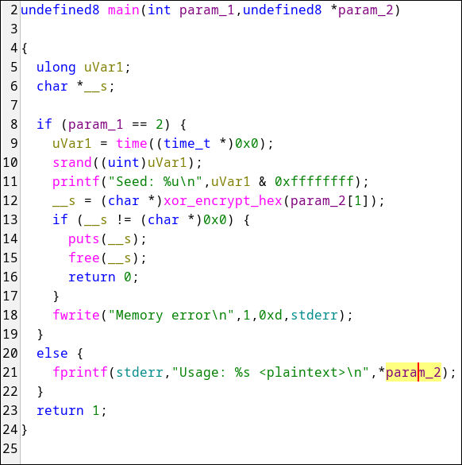
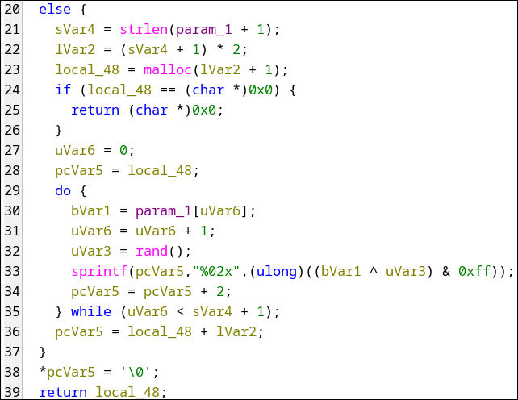
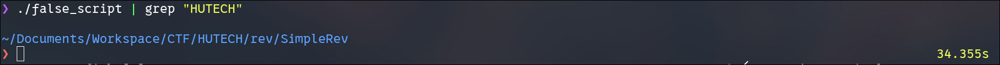
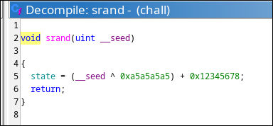
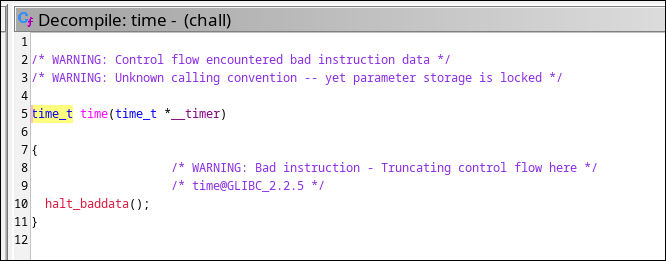
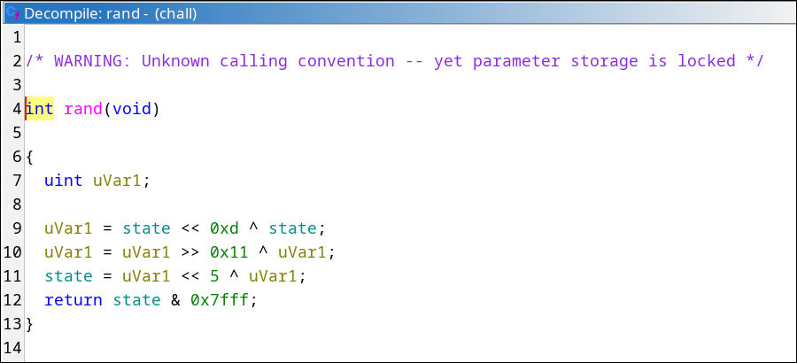
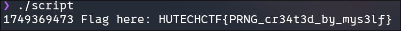

# Simple Rev

## Artifact(s)

> [Here](https://brotherctf.com/practice/file/45)

## Description

No description was provided.

## Tool(s)

- Ghidra

## Walkthrough

We are provided a binary and an output file, so I believe we need to reverse the algorithm applied on the output 
to retrieve the flag.

It seems like the program uses RNG-related functions to generate random numbers. Maybe it will be useful in encoding later on.



Jumping into `xor_encrypt_hex`, the function allocates twice the size of the input, then XOR each character of the original 
string to a randomly generated number (generate in every loop), and insert the result into the allocated space via `sprintf`.

- Note for myself: `%02x` means convert a number into HEX, then change each HEX digit to ASCII.

I did rename the variables in this function for clarity:



One thing that I learned: We just need to call `srand` once in `main`, then any function can call `rand` to generate numbers. 
No need to pass random seed as parameter.

But we haven't known the time that passed into `srand` function yet. Based on the competition date, I limit the time value in between dates of 2025
 (1735689600 to 1767225599).


After knowing how the algorithm works, I created a script to automatically decode the output that I got earlier:

```cpp
#include <cstdint>
#include <iostream>
#include <string>
#include <vector>
#include <stdlib.h>
using namespace std;

int main() {
	//Output
    string str =
        "e9e3cda72301d019ff3e4c66edeb160500bf81075f24b3fe5fc8f9ba77fcc4b457fc8e"
        "35b1580fe31e3dff0e";
    //Decrypted output
	string dec;

	//Push every two chars into a uint8_t as HEX num
	vector<uint8_t> enc;
	for(int i = 0; i<str.size(); i+=2){
		enc.push_back((uint8_t)stoi(str.substr(i, 2), nullptr, 16));
	}

	for(uint64_t l = 1735689600ULL; l <= 1767225599ULL; ++l ){
		srand(l);
		dec = "";
		char c;
		for(int i = 0; i<enc.size(); ++i){
			c = char(enc[i] ^ rand());

			//If c is out of normal char range, we can break
			if(c < 32 || c > 126){
				break;
			}

			dec += c;
		}

		cout << dec << endl;
	}

	return 0;
}

```

I run the script and left it there until result came out. Unfortunately, nothing was output, 
making me think there was something odd with the algorithm inside `chall`.



Remember the `srand` function in `main` earlier? Let's see what's inside:



The function assigns a value to a global variable `state`, which is the result of `(seed ^ 0x5a5a5a5a) + 0x12345678`. 
`seed` is the value retrived from `time` function. Luckily, `time` comes from the actual library `time.h`.



If the author modified `srand`, it could be that they also made up the function `rand` themselves. And my suspicion is correct.



Do not pay attention on these encoding lines that much. We just need to copy its logic and put it in our script.

```cpp
#include <cstdint>
#include <iostream>
#include <string>
#include <vector>
using namespace std;

int main() {
    string str =
        "e9e3cda72301d019ff3e4c66edeb160500bf81075f24b3fe5fc8f9ba77fcc4b457fc8e"
        "35b1580fe31e3dff0e";

    vector<uint8_t> enc;
    for (size_t i = 0; i + 1 < str.size(); i += 2)
        enc.push_back((uint8_t)stoi(str.substr(i, 2), nullptr, 16));

    for (uint64_t sd = 1735689600ULL; sd <= 1767225599ULL; ++sd) {
        // srand
        uint32_t state = ((uint32_t)sd ^ 0xa5a5a5a5u) + 0x12345678u;

        string res;
        bool ok = true;

        for (size_t i = 0; i < enc.size(); ++i) {
            // rand
            uint32_t x = state;
            x ^= x << 13;
            x ^= x >> 17;
            state = (x << 5) ^ x;
            x = state & 0x7fff;

            unsigned char c = enc[i] ^ (x & 0xff);
            if (c < 32 || c > 126) {
                ok = false;
                break;
            }
            res += (char)c;
        }

        if (ok) cout << sd << " " << res << '\n';
    }
}

```

Result:



## Flag

`HUTECHCTF{PRNG_cr34t3d_by_mys3lf}`
